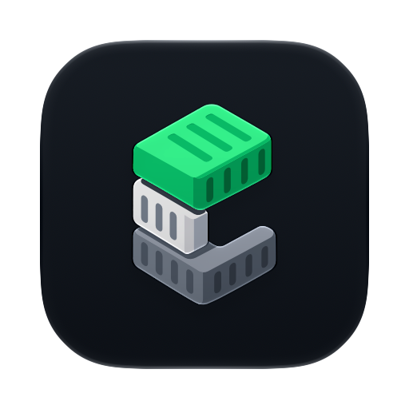
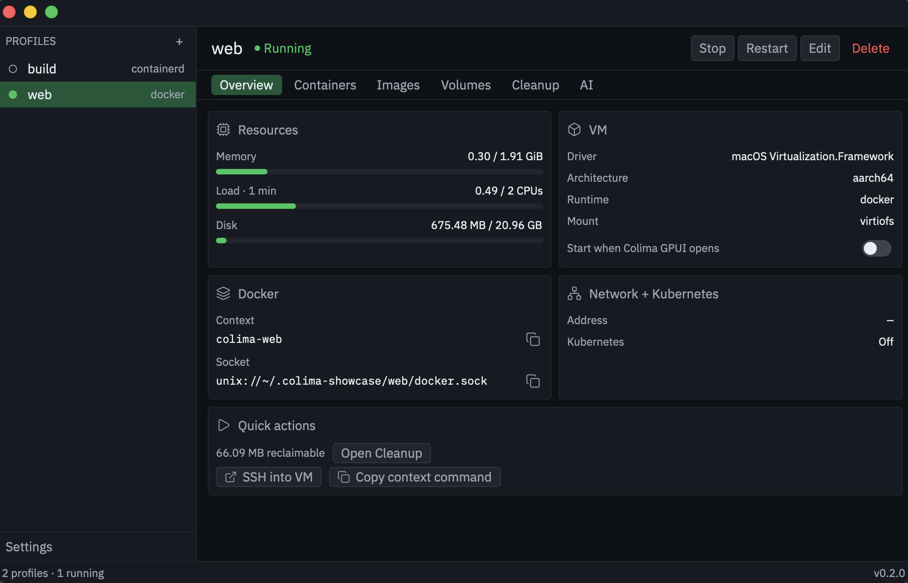

<p align="center">
  
</p>

<h1 align="center">Colima GPUI</h1>

<p align="center">
  A fast, native macOS and Linux app for managing <a href="https://github.com/abiosoft/colima">Colima</a> profiles and the Docker containers, images and volumes inside them, built with <a href="https://www.gpui.rs/">GPUI</a>, the UI framework behind the <a href="https://zed.dev">Zed</a> editor.
</p>

<p align="center">
  <a href="https://github.com/sina96/colima-gpui/actions/workflows/ci.yml"></a>
  
  
  
  <a href="https://github.com/abiosoft/colima"></a>
  <a href="https://github.com/sina96/colima-gpui/releases/latest"></a>
  <a href="LICENSE"></a>
</p>

<!-- Screenshot: add docs/screenshots/overview.png, then uncomment.
<p align="center">
  
</p>
-->

> **Status:** early and under active development. Available for macOS and Linux. [Download it](#install) or [build it from source](#build-from-source).
>
> Colima GPUI is an independent project. It isn't affiliated with or endorsed by the Colima or Zed projects.

## Features

- **Profiles:**
  - Create, start, stop, restart, edit and delete Colima profiles: CPU, memory, disk, runtime, VM type, mounts and Kubernetes.
  - Live status and start-up logs.
- **Overview:**
  - CPU, memory and disk usage per profile.
  - Quick actions: open an SSH session into the VM, or copy the `docker context` command.
- **Containers:**
  - List, start, stop, restart and remove containers.
  - Each container has a detail page with its ports, mounts, environment and live resource use.
  - Live logs you can follow or pause, select, copy and save to a file.
- **Images and volumes:** browse with sizes and filters. Image details include layers and history, and you can jump between linked containers, images and volumes.
- **Cleanup:**
  - See what's using disk space and prune unused data.
  - Return the freed space from the VM to macOS.
- **AI:** download Colima's agent skill and copy a ready-made prompt for coding agents, tailored to the selected profile.
- **Menu bar and Dock:**
  - Optionally keep running in the menu bar, with start/stop for each profile.
  - Right-click the Dock icon for the same profile actions.
- **Look:**
  - Two color profiles: Colima (default) and Zed One.
  - Each comes in light and dark, following the system or set by hand.
  - Full menu bar with keyboard shortcuts (⌘1–⌘6 switch tabs, ⌘R refreshes, ⌘, opens Settings).

## Install

### macOS

1. Install [Colima](https://github.com/abiosoft/colima#installation) and the Docker CLI if you haven't:

   ```sh
   brew install colima docker
   ```

2. Download the latest `.dmg` from [Releases](https://github.com/sina96/colima-gpui/releases/latest) for your Mac:
   - `Colima-GPUI-<version>-macos-arm64.dmg` for Apple silicon (M1 and later)
   - `Colima-GPUI-<version>-macos-x86_64.dmg` for Intel

   Not sure which you have? Apple menu → About This Mac: "Chip: Apple M…" means arm64, "Processor: Intel" means x86_64.

3. Open the `.dmg` and drag **Colima GPUI** to **Applications**.

4. **First launch.** Colima GPUI isn't notarized by Apple yet, so macOS blocks it the first time ("Apple could not verify…"):
   1. Open it from Applications once and close the warning.
   2. Open **System Settings → Privacy & Security**, scroll down, and click **Open Anyway** next to Colima GPUI.
   3. Confirm with your password or Touch ID. From then on it opens normally.

   Or, from the terminal, remove the download quarantine instead:

   ```sh
   xattr -dr com.apple.quarantine "/Applications/Colima GPUI.app"
   ```

To check a download, compare it with `SHA256SUMS` from the same release: `shasum -a 256 -c SHA256SUMS --ignore-missing`.

**Something wrong?** Start the app from a terminal with `COLIMA_GPUI_LOG=1` set, e.g. `COLIMA_GPUI_LOG=1 "/Applications/Colima GPUI.app/Contents/MacOS/colima-gpui"` on macOS, and include what it prints in a [bug report](https://github.com/sina96/colima-gpui/issues/new?template=bug_report.yml).

**Updating:** download the new version and replace the app in Applications. In-app updates are planned.

### Linux

1. Install [Colima](https://colima.run/docs/installation/) and the Docker CLI for Linux.
2. Download the `.AppImage` for your architecture from [Releases](https://github.com/sina96/colima-gpui/releases/latest): `Colima-GPUI-<version>-linux-x86_64.AppImage` or `Colima-GPUI-<version>-linux-aarch64.AppImage` (`uname -m` shows your architecture).
3. Make it executable and run it:

   ```sh
   chmod +x Colima-GPUI-<version>-linux-<arch>.AppImage
   ./Colima-GPUI-<version>-linux-<arch>.AppImage
   ```

AppImages need FUSE 2 (the `libfuse2` package on Debian/Ubuntu; `libfuse2t64` on Ubuntu 24.04). Without FUSE, run `./Colima-GPUI-<version>-linux-<arch>.AppImage --appimage-extract-and-run` instead.

Check a Linux download with `sha256sum -c SHA256SUMS --ignore-missing` using `SHA256SUMS` from the same release.

## Requirements

- macOS 11 or later, or a Linux desktop with X11 or Wayland. Colima itself may need a newer macOS, depending on the VM type.
- [Colima](https://github.com/abiosoft/colima#installation) and the Docker CLI, for example:

  ```sh
  brew install colima docker
  ```

The app finds `colima` and `docker` in Homebrew (`/opt/homebrew/bin`, `/usr/local/bin`), Nix (`~/.nix-profile/bin`) or your `PATH`. To use a binary somewhere else, set `COLIMA_BIN` to its path.

## Build from source

You need [Rust](https://rustup.rs) and [just](https://github.com/casey/just). On macOS, also install the Xcode Command Line Tools (`xcode-select --install`); `brew install just` installs the task runner. The exact Rust version is pinned in `rust-toolchain.toml`, and `rustup` installs it automatically.

```sh
git clone https://github.com/sina96/colima-gpui.git
cd colima-gpui
just app   # builds dist/Colima GPUI.app
open "dist/Colima GPUI.app"
```

`just dmg` builds a macOS disk image as well, and `just run` starts a debug build without packaging. On Linux, install the build dependencies in [CONTRIBUTING.md](CONTRIBUTING.md#linux), then run `just appimage` to build `dist/Colima-GPUI-<version>-linux-<arch>.AppImage`.

An app you build yourself isn't quarantined, so macOS opens it without the warning above. See [`packaging/README.md`](packaging/README.md) for details.

## Contributing

Contributions are welcome. [CONTRIBUTING.md](CONTRIBUTING.md) explains how to build, test and open a pull request. [AGENTS.md](AGENTS.md) has the architecture and design rules, for humans and coding agents alike.

- Questions and bug reports: see [SUPPORT.md](SUPPORT.md).
- Security problems: see [SECURITY.md](SECURITY.md); please don't open a public issue.
- Everyone taking part follows the [Code of Conduct](CODE_OF_CONDUCT.md).
- Notable changes are listed in the [changelog](CHANGELOG.md).
- What's coming next is in the [roadmap](docs/roadmap.md).

## Credits

- [Colima](https://github.com/abiosoft/colima) does the real work; this app drives its CLI.
- [GPUI](https://github.com/zed-industries/zed/tree/main/crates/gpui) and the One Dark / One Light colors come from Zed.
- Fonts: [IBM Plex Sans](https://github.com/IBM/plex) and [Lilex](https://github.com/mishamyrt/Lilex) (SIL Open Font License).
- Icons: [Lucide](https://lucide.dev) (ISC License).

## License

[MIT](LICENSE)
